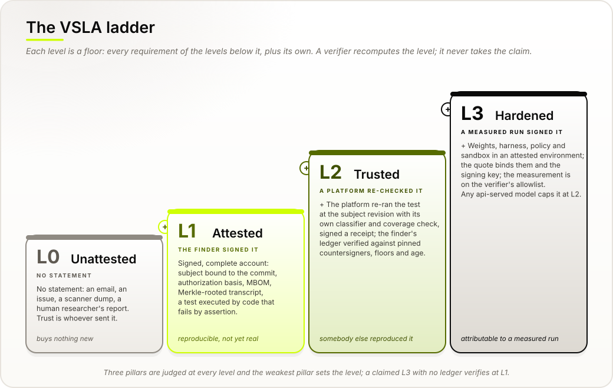
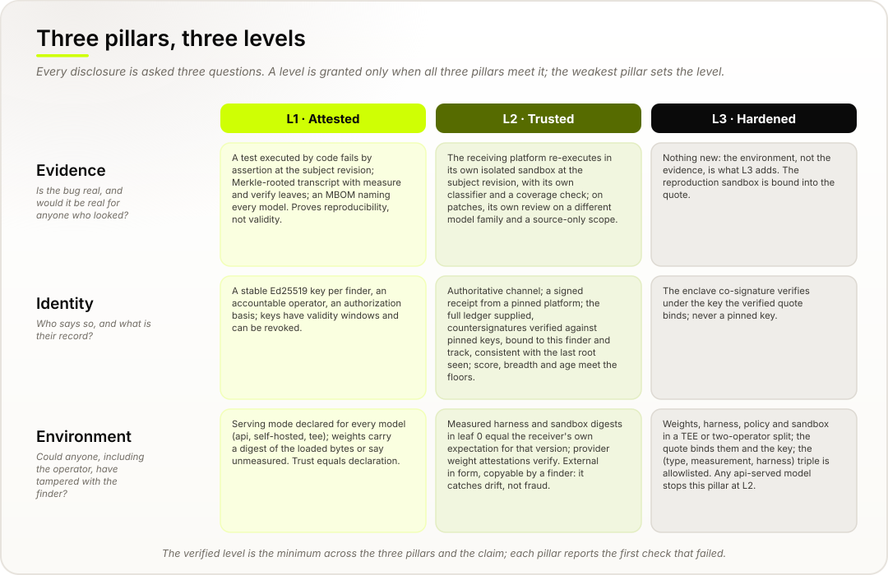
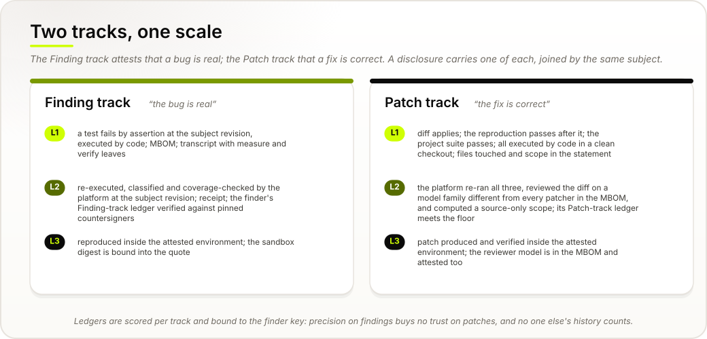
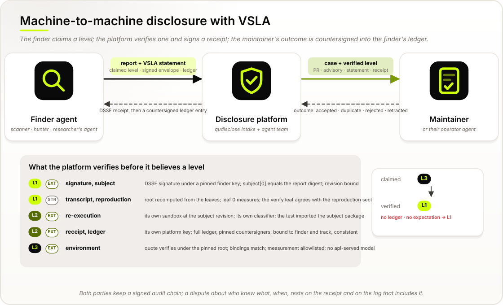
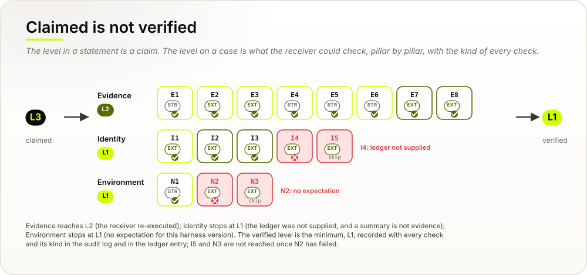
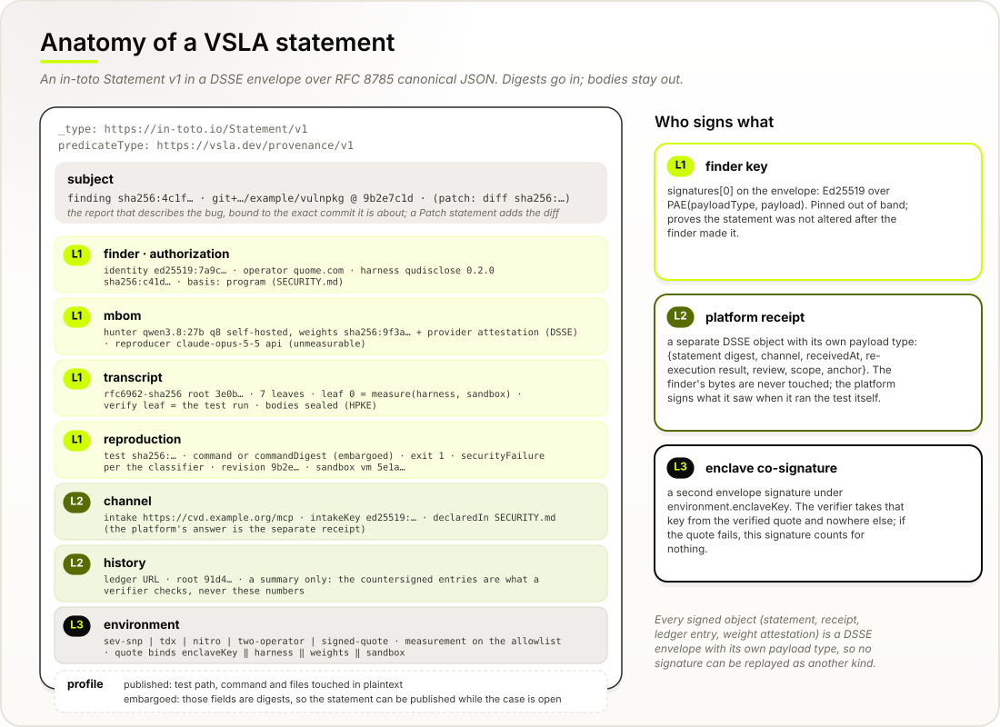
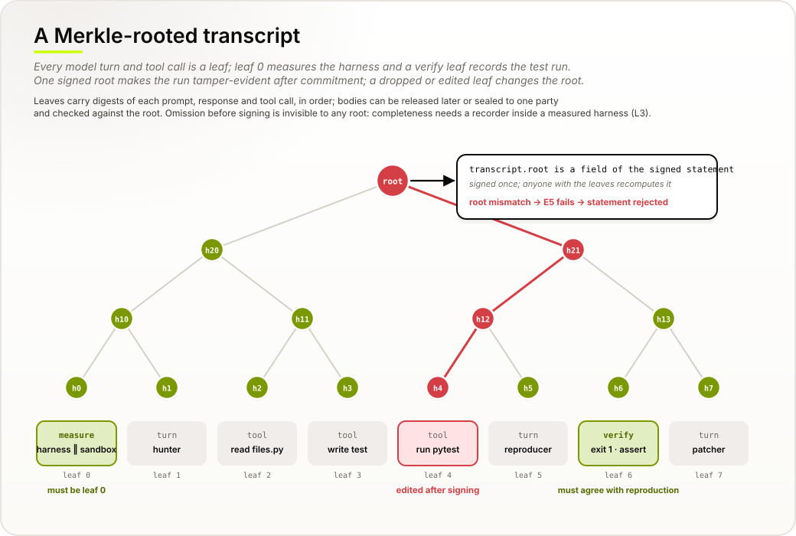
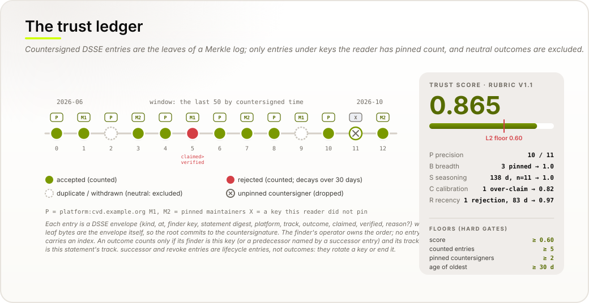
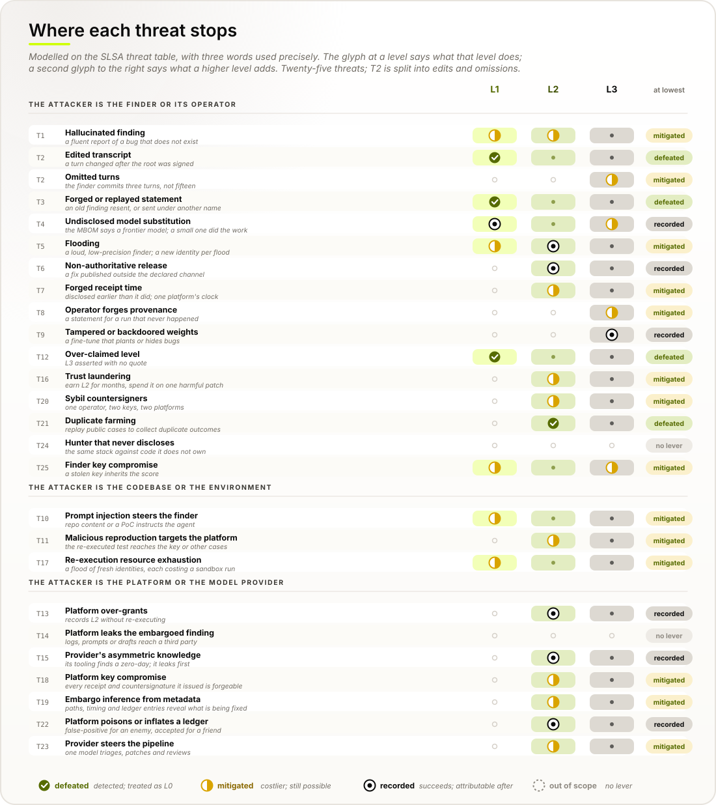
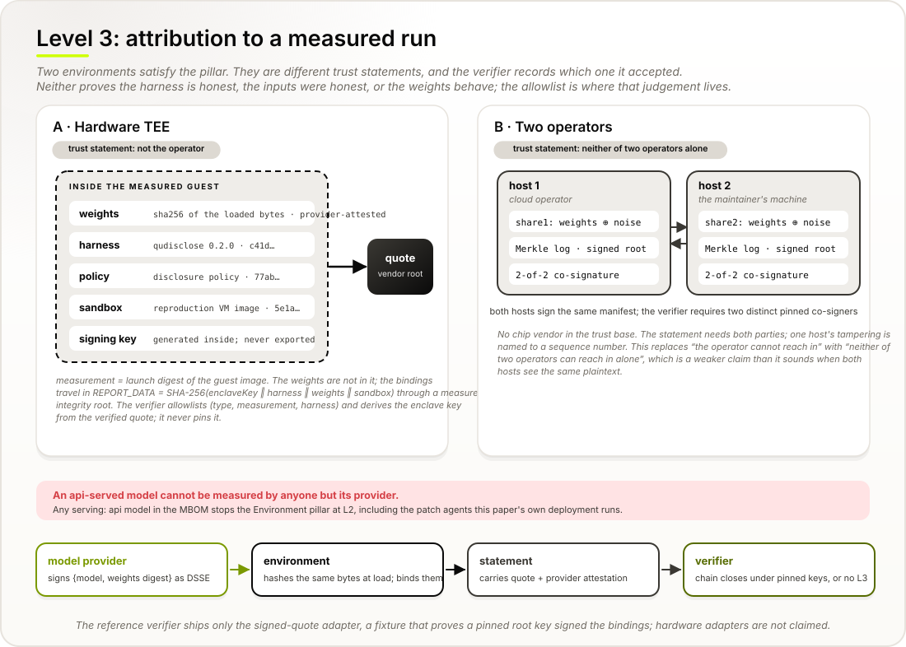

<p align="center">
  
</p>

<h3 align="center">Vulnerability-disclosure Supply-chain Levels for Agents.</h3>

<p align="center">
  What SLSA is to builds, VSLA is to machine-to-machine vulnerability disclosure:<br>
  a ladder of levels, a provenance format, a threat model, a verification procedure, a trust score.<br>
  Said "vee-salsa".
</p>

<p align="center">
  
  
  
  
  
  
</p>

<p align="center">
  <a href="paper/vsla.pdf">Paper (PDF)</a> ·
  <a href="paper/vsla.docx">Paper (Word, for comments)</a> ·
  <a href="spec/v1.0/README.md">Specification</a> ·
  <a href="spec/v1.0/levels.md">Levels</a> ·
  <a href="spec/v1.0/threats.md">Threats</a> ·
  <a href="spec/v1.0/provenance.md">Provenance</a> ·
  <a href="spec/v1.0/verification.md">Verification</a> ·
  <a href="spec/v1.0/trust-rubric.md">Trust rubric</a> ·
  <a href="schema/examples">Signed examples</a>
</p>

---

## The problem

Coordinated vulnerability disclosure was designed for people with inboxes and a 90-day clock. Both ends are
now machines: scanners, fuzzers and research agents find bugs at machine speed, and maintainers increasingly
answer with agents that triage, reproduce, patch and publish ([qudisclose](https://github.com/quome-cloud/qudisclose)
is one). What is missing is a way for the receiving machine to know how far to trust the sending one.

A signed email proves who sent a report. It does not prove the bug is real, that the model named did the
work, that the account of the work is complete, that the weights were the weights, or when the maintainer
actually received it. Those are the things a machine receiver has to decide on, a thousand times a day.

## The ladder

<p align="center"></p>

| Level | One line | What it does to the threats |
|---|---|---|
| **L0 Unattested** | an email, an issue, a scanner dump | nothing; trust is whoever sent it |
| **L1 Attested** | the finder signed a complete, reproducible account: authorization basis, model bill of materials, Merkle-rooted transcript, a test executed by code at the subject revision | *defeats* forged, replayed or edited-after-signing statements and over-claimed levels; *mitigates* hallucinated findings (the test was run; it may still be wrong); *records* model substitution |
| **L2 Trusted** | an authoritative platform re-ran the test itself, classified it, checked its coverage, reviewed the patch on a different model family, and signed a receipt; the finder's countersigned ledger verifies against the countersigners the platform pins and meets the floors | *mitigates* flooding, forged receipt time, trust laundering, Sybil countersigners, hostile reproductions, embargo inference; *records* non-authoritative release |
| **L3 Hardened** | weights, harness, policy, sandbox and signing key inside an attested environment (TEE or two-operator split); the quote binds them; the measurement is on the verifier's allowlist; every weight digest matches a provider attestation | *mitigates* forged provenance and model substitution; *records* tampered weights. Any api-served model caps this pillar at L2 |

Every level is judged on three pillars, **Evidence** (is the bug real?), **Identity** (who says so, and what
is their record?) and **Environment** (could anyone have tampered with the sayer?), and the weakest pillar
sets the level. Every check is **external** (against a pinned key, an expectation the receiver obtained on its
own, or the receiver's own execution) or **structural** (the statement against itself); only external checks
separate the levels.

<p align="center"></p>

## Two tracks

"The bug is real" and "the fix is correct" are different claims, so they get different ladders with the same
scale, as SLSA split Build from Source. A disclosure reports both: *Finding L2 · Patch L2*.

<p align="center"></p>

## How a disclosure flows

<p align="center"></p>

The finder **claims** a level in its statement. The platform **verifies** one: signature, Merkle root and verify
leaf, its own re-execution of the reproduction at the subject revision with its own classifier, the declared
channel, the ledger's countersignatures against the keys it pins, the environment quote against its
allowlist. The maintainer **countersigns the outcome**, which lands in the finder's ledger and raises or lowers
its score for next time.

<p align="center"></p>

## What a statement looks like

An [in-toto Statement v1](https://github.com/in-toto/attestation) with predicate type
`https://vsla.dev/provenance/v1` in a [DSSE](https://github.com/secure-systems-lab/dsse) envelope over
RFC 8785 canonical JSON. Digests go in; bodies stay out, and in the **embargoed profile** the test path, command
and files touched are digests too, so that form of the statement reveals nothing while the case is open.

<p align="center"></p>

The transcript is committed with an RFC 6962 Merkle tree: one leaf per model turn, tool call and verification
step; leaf 0 measures the harness and a verify leaf records the test run. A finder can prove one turn with an
inclusion proof without releasing the prompts; a turn edited, dropped or reordered **after signing** changes the
root as visibly as a forged one. A turn omitted before signing does not, and only a recorder inside a measured
harness (L3) can attest completeness.

<p align="center"></p>

The platform's countersignature is a separate **receipt**, a DSSE envelope with its own payload type over
`{statement digest, channel, received at, re-execution}`, where re-execution carries the platform's status, its
own classification, the coverage check, the sandbox's isolation class and, for patches, its own review and the
computed scope. The finder's payload is never touched after signing, and "who knew what, when" is settled by
signatures and the transparency log the receipt is anchored in, rather than by one platform's clock.

## Trust history

L2 is earned the way commit rights are earned: a signed, append-only ledger of past disclosures with
countersigned outcomes, as DSSE entries. A verifier counts only countersigners it has pinned, checks the ledger
extends the one it saw last time, and recomputes the score. Duplicates and withdrawals are neutral; a
non-authoritative release, a retracted patch or a fork zeroes the score; the floor has a minimum age so two
colluding keys cannot reach L2 on day zero.

<p align="center"></p>

The [rubric](spec/v1.0/trust-rubric.md) is six lines of arithmetic so that two platforms compute the same
number from the same ledger, and it lists the ways it can be gamed and what it does about each.

## Where each threat stops

<p align="center"></p>

The full table of 25 rows, with residual risks, is in [threats.md](spec/v1.0/threats.md). Three words are used
precisely: *defeated* (detected mechanically, treated as L0), *mitigated* (costlier, still possible) and
*recorded* (it succeeds and is attributable afterwards). Most of what VSLA does is the second and third kind.
Prompt injection is mitigated at every level and eliminated at none; a hunter that never discloses is out of
scope by construction.

## Level 3 environments

<p align="center"></p>

Either a hardware TEE (SEV-SNP, TDX, Nitro) or a two-operator split, where the signing key is a 2-of-2 group across independently
owned hosts, satisfies the Environment pillar at L3. They are different trust statements ("not the operator"
versus "neither of two operators alone"), the verifier records which it accepted, and L3 proves which bytes
ran, not that the harness was honest or the weights well behaved. The enclave key is derived from the verified
quote, never pinned. Any api-served model in the MBOM caps the pillar at L2.

## Try the reference verifier

```bash
git clone https://github.com/AAI-Society/vsla && cd vsla
python -m venv .venv && .venv/bin/pip install -e ".[dev]"
.venv/bin/python tools/make_examples.py          # fresh keys, real signatures, both tracks at every level
.venv/bin/python tools/vsla_verify.py schema/examples/finding-l3.dsse.json \
    --keyring schema/examples/keyring.json --expectations schema/examples/expectations.json \
    --report schema/examples/report.json --leaves schema/examples/leaves.json \
    --ledger schema/examples/ledger.json --receipt schema/examples/finding-l3.receipt.dsse.json \
    --reexec schema/examples/reexecution.json --intake https://cvd.example.org/mcp --require-anchor
#   ... "VSLA finding: claimed L3, verified L3"
.venv/bin/python -m pytest -q                    # each attack the reviews demonstrated is pinned by a regression test
```

Drop `--reexec` and `--receipt` and Evidence stops at L1: a coordinator holding the statement but not the code
gets the honest answer. Drop `--ledger` and Identity stops at L1: a self-reported history summary is not
evidence. Drop `--expectations` and Environment stops at L1: there is nothing to compare the measured harness
to. Replace every ledger signature with garbage and every entry is dropped. Present a ledger that does not
extend the one the verifier saw last time and the check says `ledger-fork`. Assert a review in the statement
and the Patch track stays at L1 until the receiver's own review is in the receipt. Sign a receipt with any key but
the platform key the statement names, including the finder's own, and it is not a receipt. Present another
finder's ledger or a Finding ledger with a Patch statement, and Identity stays at L1. Omit an entry the verifier
countersigned (`--required-entries`) and it says `ledger-fork`; reorder your ledger and the score does not move,
because the window is by countersigned time. Anchor a receipt with a bare timestamp and `--require-anchor` refuses it.

## Pilots

Nothing here has been measured yet. The hypothesis is narrow: *a machine-generated patch that arrives with a
verified VSLA Patch L2 statement is accepted more often, and no less safely, than an identical unattested
one.* "Merged faster" alone is the wrong headline, so acceptance and time-to-merge are paired with revert
rate and false acceptance on a seeded adversarial set. We are in discussions with pilot partners and keep the
design broad until they have agreed: a partner-hosted pilot on already-triaged bugs against the partner's own
baseline, and a staging pilot on a *private* fork where each upstream is notified through its declared channel
at discovery. Nothing is released outside a maintainer's authoritative channel and the whole pipeline runs on
self-hosted weights. Details in the [paper](paper/vsla.pdf), section 9.

## Repository layout

```
spec/v1.0/        levels · tracks · requirements (VSLA-F/P/V ids) · provenance · verification · threats · trust-rubric · faq
schema/           vsla-provenance-v1.schema.json · examples/ (signed statements, DSSE receipts, keyring, expectations, ledger, leaves)
tools/            vsla_verify.py (reference verifier: RFC 8785 JSON, Merkle, DSSE, rubric v1.1) · make_examples.py
paper/            vsla.tex → vsla.pdf (tectonic) · build_docx.py → vsla.docx (for comments)
figures/          build_figures.py · style.py · fig-*.svg · pdf/ (for the paper)
assets/           logo.svg · banner.svg
tests/            the reference verifier against the examples
```

Regenerate everything: `python figures/build_figures.py && python tools/make_examples.py && (cd paper && tectonic vsla.tex)`.

## What already exists, and what VSLA adds

Every primitive in VSLA is borrowed on purpose. Signed in-toto statements for AI-produced code are being
standardised now ([in-toto AI code-generation predicate proposal](https://github.com/in-toto/attestation/issues/604),
[attest](https://github.com/Parth2412/attest)); Merkle-logged, DSSE-signed agent runs exist
([Agent Flight Recorder](https://arxiv.org/abs/2609.01931), [NovaFabric](https://arxiv.org/abs/2609.12582),
[VCT](https://www.mdpi.com/2079-9292/15/21/5022)); a TEE architecture for attested model runs, with a consistency-proofed log recommended for its output, is
proposed ([grant-evaluation paper](https://arxiv.org/abs/2604.25200)); agent reputation ledgers are proposed
([AgentReputation](https://arxiv.org/abs/2605.00073), [Zer0n](https://arxiv.org/abs/2601.07019)); and a
SLSA-style tiering has been applied to [agent skill packages](https://arxiv.org/abs/2603.00195). The "AI slop"
problem is documented from the maintainer's side ([HeroDevs](https://www.herodevs.com/blog-posts/the-security-slop-slavine-why-ai-cant-replace-domain-expertise),
[survey with a Slop-Score](https://arxiv.org/abs/2608.25667)).

What we could not find, and what VSLA adds: graded levels for the *disclosure* itself with separate Finding and
Patch tracks; reproduction **executed by code** and **re-executed by the receiver** as the rule that separates
the levels; a model bill of materials in every disclosure; the platform receipt as the countersignature that
settles who knew what, when, to the extent the log it is anchored in says so; and a ledger countersigned by the
party that paid to check the report and counted only by readers who pinned that party, which is what lets it
replace a bounty without becoming a forgeable credential. Section 3 of the paper is the full comparison,
including the limits VSLA inherits (attestation is not correctness; reputation has a cold start and can be gamed).

## Status and honesty

This is draft v1.0, revision 4. Two adversarial reviews of the first draft (from the standpoint of a principal security engineer and of a
threat-intelligence researcher) found the reference verifier
granting levels it had not checked in six places, a rubric two colluding keys could pass on day zero, a threat
table that said "defeated" where only "mitigated" or "recorded" was true, an L3 story that pinned the enclave
key backwards and did not match how confidential-VM measurements work, and a staging pilot that was the
inverse of coordinated disclosure. A second-round review of the second draft probed the artefacts and found ten
more: a finder-signed receipt reaching L2, borrowed and cross-track ledgers, a finder-ordered window, the
platform's own ledger entries never enforced, a forgeable runner report, an import-only coverage check, scope
parsing gaps, a two-operator quote one root co-signed twice, canonical form never enforced, and anchoring claimed but
never checked. A third round, from the standpoint of a transparency-log maintainer and again of the threat-intelligence
researcher, found the specification undecided on who owns the ledger's index and which clock governs validity, with
honest finders forking as a result, key rotation specified but unimplemented, a timestamp read as log inclusion, and
three read surfaces leaking embargoed cases. All of that is changed and pinned by tests: every attack the
reviews demonstrated is pinned by a regression test in [`tests/`](tests), listed in [the verification chapter](spec/v1.0/verification.md). The
Environment pillar's L3 adapters remain an interface with a reference signed-quote implementation; real
SEV-SNP, TDX and Nitro quote verification are not claimed as done. Receipt anchoring has two forms, log inclusion (signed checkpoint plus inclusion
proof, which the verifier requires) and a signed timestamp (accepted only by explicit policy); Rekor and SCITT
adapters that map their proofs onto the inclusion form are not implemented. Expect the rubric to be versioned again once the pilots produce data.

## Provenance

This repository was donated by Quome, Inc. to the [Advanced AI Society](https://advancedaisociety.org), which now maintains it.

VSLA was developed at Quome and the [Advanced AI Society](https://advancedaisociety.org) alongside [qudisclose](https://github.com/quome-cloud/qudisclose), the open-source implementation described in the paper.

## License

The specification, paper and figures are licensed [CC BY 4.0](LICENSE-SPEC); the schema, tools and tests are
licensed [Apache 2.0](LICENSE). A framework meant for other people's intakes has to be free to adopt.
Copyright (c) 2026 Quome, Inc.
