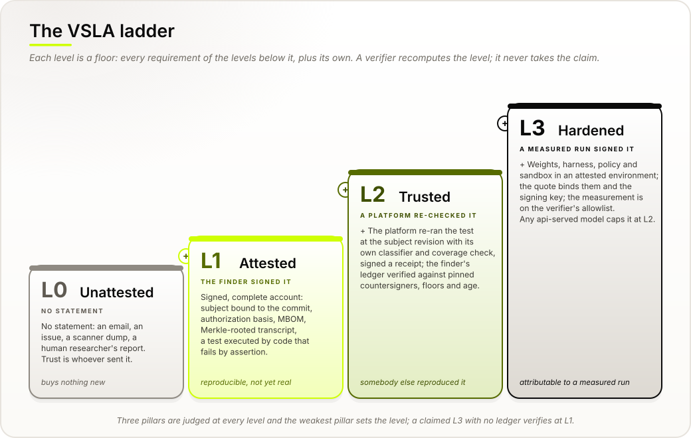
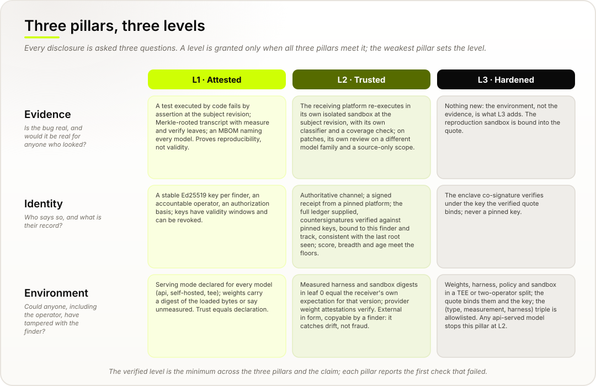
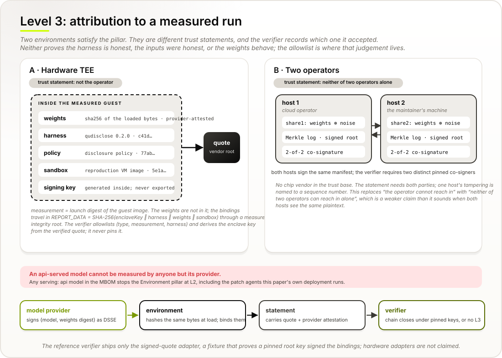

# Levels

VSLA has four levels. Each level is a floor: a disclosure at level *n* meets every requirement of levels
below *n* as well as its own. Levels are per track (Finding, Patch); a disclosure that carries both has a
level on each.

Every level is judged on three **pillars**. A level is granted only when all three pillars meet it; the
weakest pillar sets the level.

| Pillar | The question it answers | What it is made of |
|---|---|---|
| **Evidence** | Is the bug real, and would it be real for anyone who looked? | executable reproduction, transcript commitment, model bill of materials |
| **Identity** | Who says so, and what is their record? | finder key, operator, authorization basis, authoritative channel, trust ledger |
| **Environment** | Could anyone, including the operator, have tampered with the finder? | serving mode, measured harness, attested weights, enclave or two-operator split |

## L0 · Unattested

No statement. The disclosure is an email, an issue, a webhook, a scanner dump. Whatever trust it has is the
trust the receiver already placed in the sender. Everything that exists today is L0, and L0 is not a failure:
it is where the ladder starts. A human researcher's report is L0 by definition, and a platform's policy MUST
NOT route L0 below machine L1 or L2 on the strength of the level alone; the level grades machine evidence,
not people.

## L1 · Attested

*"The finder signed a complete, reproducible account of what it did."*

The disclosure carries a VSLA statement, signed by the finder's key, that binds together:

- the **subject**: a digest of the report and the exact revision of the code it concerns;
- the **authorization basis** on which the finder tested that code;
- a **model bill of materials** naming every model that took part, how it was served, and its weight
  digest when the operator measured it;
- a **Merkle-rooted transcript** of every model turn and tool call, in order, so that nothing in the account
  can be changed after it is signed;
- a **reproduction** that was executed by code, not asserted by a model: a test, the command, the exit code,
  the classification of the failure, and the revision it ran against, which must be the subject's. For the
  Finding track the test must fail on the vulnerable revision with an assertion; for the Patch track it must
  pass after the patch, along with the project's suite.

What L1 buys the receiver: a report it can reject mechanically if it is incomplete, replayed, or edited after
signing; a test it can run with one command; and a record of which model said what, so that a bad model can
be identified and excluded later.

What L1 does not buy: any reason to believe the bug is real. The finder wrote the test and set the flag; L1
proves the test is reproducible, not that it is right. It buys no reason to believe the finder *tends* to be
right, or that the operator did not tamper with the model or the statement, or that the transcript is
complete. The finder signed it; that is all.

## L2 · Trusted

*"An authoritative platform received it, re-checked it, and the finder has a countersigned record."*

Everything in L1, plus:

- the disclosure went to the **authoritative channel** for the codebase, and the platform **countersigned a
  receipt** binding the receipt time and the channel, anchored in a transparency log where the platform
  offers one;
- the platform **independently re-executed** the reproduction in its own isolated sandbox, at the subject
  revision, classified the failure with its own classifier, checked that the test exercised the code the
  report names, and put the result in the receipt. The finder's word about the exit code is no longer the
  only word. On the Patch track the platform also ran its own adversarial review on a different model family,
  and the diff touches source only;
- the finder has a **trust ledger**: an append-only log of its past disclosures, each with an outcome
  countersigned by a maintainer or platform. The receiver verifies the countersignatures it has pinned, checks
  the ledger extends the one it saw last time, and recomputes the [trust score](trust-rubric.md) against its
  floors, including a minimum age.

What L2 buys the receiver: a finding somebody other than the finder reproduced; a finder with a track record
it can read, rate-limit and revoke per identity; a cost on flooding and a record of non-authoritative release;
and a timeline of who knew what, when, that is as good as the platform's clock and better when anchored.

What L2 does not buy: assurance about the model itself, or about the transcript's completeness. The operator
could still have substituted, quantized, fine-tuned or backdoored the weights, or run the signing key outside
the real pipeline. Nor does L2 mean a patch may be merged unread on a security-sensitive surface: a level is
evidence about this disclosure, not a prediction about the next.

## L3 · Hardened

*"The finder ran where no one, including its operator, could reach in."*

Everything in L2, plus:

- the model **weights, the harness, the disclosure policy and the reproduction sandbox** were served from an
  **attested environment**: a hardware TEE (SEV-SNP, TDX, Nitro) or a two-operator split, where neither operator alone can read, alter or sign;
- the environment's **quote** binds the signing key, the harness digest, every weight digest and the sandbox
  digest, and the receiver holds an **allowlist** of acceptable measurements for that harness; each weight
  digest matches a provider-signed attestation;
- the **signing key lives in the environment** and never with the operator, so a statement cannot be
  produced outside the measured run.

What L3 buys the receiver: attribution. A statement is attributable to a measured environment running named
weights, so model substitution, forged provenance and tampered weights become visible or traceable, and a
model provider that finds and leaks a bug can be shown to have done so.

What L3 does not buy: an honest harness (the allowlist is where that judgement lives), honest inputs (the
operator still chooses what the enclave sees), or well-behaved weights (attestation names the bytes, not the
behaviour). An API-served model cannot be measured, so a pipeline with any API-served model stops at L2 on the
Environment pillar.

**Where the SLSA analogy breaks.** SLSA Build L3 is non-forgeable because a *third party* (the hosted build
platform) holds the signing key away from the producer. VSLA L2 is a receiver-side property with no SLSA
analogue (the consumer re-executes and countersigns), and VSLA L3 keeps the key in hardware the *producer*
operates. The analogue of SLSA's trusted builder would be a third-party finder-hosting platform that holds the
key; VSLA does not define that environment type in v1.0, and a reader who imports SLSA L3's guarantee into
VSLA L3 will over-trust it.

## Beyond L3

VSLA v1.0 stops at L3 deliberately. Candidates for a future level, listed so that nobody mistakes their
absence for an oversight: two independent finders on different model families reproducing the same finding;
a reproduction re-executed by a third-party witness; a third-party finder-hosting environment type; formal
verification of the patch's property. These are useful; they are not yet common enough to standardise.
