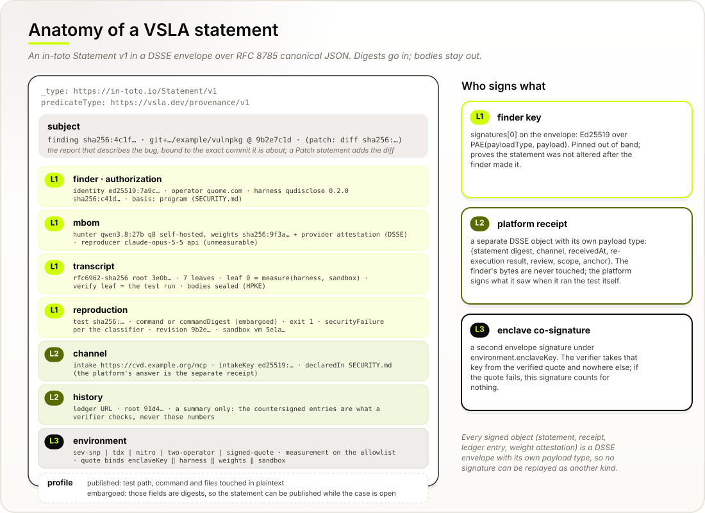
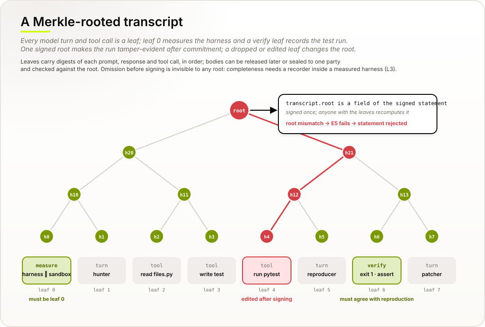
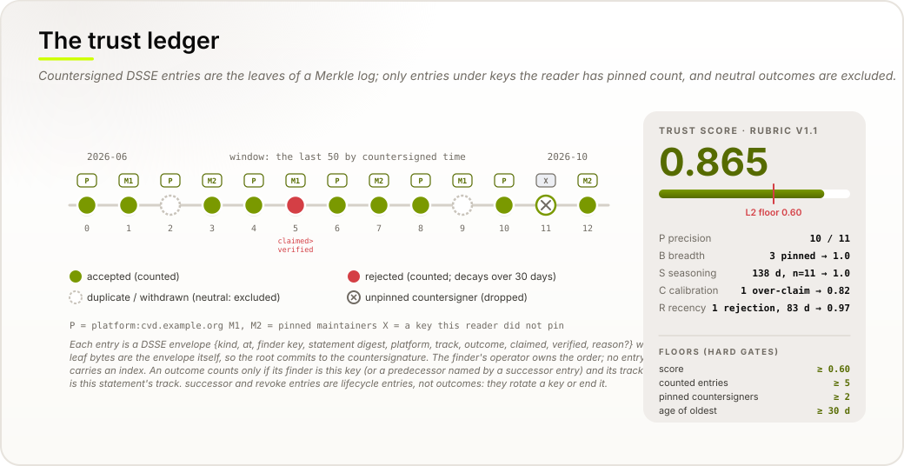

# Provenance: the VSLA statement

<p align="center"></p>

A VSLA statement is an [in-toto Statement v1](https://github.com/in-toto/attestation/blob/main/spec/v1/statement.md)
with `predicateType` `https://vsla.dev/provenance/v1`, carried in a
[DSSE](https://github.com/secure-systems-lab/dsse) envelope with `payloadType`
`application/vnd.in-toto+json`. The JSON Schema is at
[`schema/vsla-provenance-v1.schema.json`](../../schema/vsla-provenance-v1.schema.json). Three further signed
objects use DSSE with their own payload types: the [receipt](#receipt-the-platform-countersignature), the
[ledger entry](#trust-ledger) and the [weight attestation](#weight-attestation).

**Canonical JSON** everywhere in VSLA is [RFC 8785](https://www.rfc-editor.org/rfc/rfc8785) (JCS): keys sorted
by UTF-16 code units, no whitespace, ES6 number formatting (integers beyond 2^53 are IEEE-754 doubles and
serialise as such), UTF-8 with no lone surrogates. Every signed payload MUST be byte-canonical with no duplicate
keys, and a verifier parses it strictly: a payload that does not re-serialise to itself, or exceeds 4 MiB, or nests
deeper than the parser allows, fails E1 (or I3/I4 for a receipt or ledger entry), so two conforming parsers cannot
read different values from one signature and a hostile payload cannot crash a verifier. Two
implementations that canonicalise differently will reject each other's signatures and compute different ledger
roots, which is why this is a MUST and not a suggestion.

Design rule: **digests go in, bodies stay out.** The statement commits to the transcript, the PoC, the diff
and the test output by digest, and carries none of their text. In the **embargoed profile** the paths and
commands that would describe the bug are digests too, so the statement can be published, attached to an OSV
advisory and kept in a public ledger while the case is open. In the **published profile** they are plaintext.

## Subject

```json
"subject": [
  {"name": "finding:1b2e",            "digest": {"sha256": "<report digest>"}},
  {"name": "git+https://github.com/example/vulnpkg", "digest": {"gitCommit": "<commit>", "sha256": "<tree digest>"}}
]
```

`subject[0]` is the report: SHA-256 over the canonical JSON of the fields that describe the bug (title,
description, repo, package, affected versions, PoC, CWE, CVSS vector, suggested fix), never contact or
credit. It identifies *this report*; it is not a deduplication key, because two finders describe one bug
differently, and deduplication is the platform's triage, not the subject's. `subject[1]` is the code: the git
commit, plus a tree digest when the finder worked from something other than a git checkout.
`reproduction.revision` MUST equal the commit. In the embargoed profile `subject[1].name` is
`repo:sha256:<digest of the URL>`; the published profile carries the URL.

A Patch-track statement uses the same `subject[0]` and adds the diff as `subject[2]`:

```json
  {"name": "patch:1b2e", "digest": {"sha256": "<unified diff digest>"}}
```

## Predicate

| Field | Level | Contents |
|---|---|---|
| `vslaVersion` | L1 | `"1.0"` |
| `track` | L1 | `"finding"` or `"patch"` |
| `claimedLevel` | L1 | integer 1 to 3; what the finder asserts |
| `profile` | L1 | `published` (default) or `embargoed` |
| `finder` | L1 | `identity` (stable name), `publicKey` (`ed25519:<hex>`), `operator` (domain or org), `harness` `{name, version, digest}` |
| `authorization` | L1 | `basis`: `ownership` \| `program` \| `engagement` \| `safe-harbour`; `ref`: the scope URL, engagement id or policy. Recorded, not enforced ([VSLA-F-19](requirements.md)) |
| `mbom` | L1 | `models[]`: `{role, provider, name, family, version?, serving: api\|self-hosted\|tee, weights?: {digest \| unmeasured: true, quantization?, attestation?: <DSSE>}, scan?: {uri, digest}}`; `tools[]`: `{name, digest?}` |
| `transcript` | L1 | `algorithm: "rfc6962-sha256"`, `root`, `leafCount`, `firstLeaf` (the `measure` leaf), `leaves?[]`, `sealedTo?` |
| `reproduction` | L1 | `test: {path?, digest}`, `command` or `commandDigest`, `expectedExit`, `observedExit`, `securityFailure`, `revision`, `executor: "code"`, `sandbox: {backend, isolation: vm\|container\|process, digest?}`, `outputDigest`, `startedAt`, `finishedAt` |
| `patch` | L1 (Patch track) | `diffDigest`, `filesTouched[]` or `filesTouchedDigest`, `scope: source-only\|mixed`, `applied`, `reproductionPasses`, `suitePasses`, `attempts`, `review?: {approved, reviewerRole, reviewerFamily?, verdictDigest}` (the finder's own review; informational) |
| `injection` | L1 | `scannerFlags[]`, `modelFlagged` (bool) |
| `channel` | L2 | `intake` (URL), `intakeKey`, `declaredIn` (`SECURITY.md`, `security.txt`, `registry`, `policy`): where the finder sent this statement. The platform's answer is the separate [receipt](#receipt-the-platform-countersignature) |
| `history` | L2 | `ledger` (URL), `root`, `entries`, `accepted`, `rejected`, `countersigners`, `score`, `floor`, `oldestAt`. A summary; the entries themselves are what a verifier checks |
| `environment` | L3 | `type: sev-snp\|tdx\|nitro\|two-operator\|signed-quote\|none`, `measurement: {algorithm, value}`, `measures[]`, `enclaveKey` (the signing key the quote binds), `quote` (base64; type-specific), `rootOfTrust`, `coSigners?[]` (two-operator) |
| `timestamps` | L1 | `startedAt`, `finishedAt` of the run |

The schema marks the L1 fields required and the L2/L3 fields optional; a verifier treats a missing L2/L3
section as a failed check for that level ([VSLA-V-3](requirements.md)).

### Profiles

| Field | published | embargoed |
|---|---|---|
| `reproduction.test.path` | present | absent (digest only) |
| `reproduction.command` / `commandDigest` | `command` | `commandDigest` |
| `patch.filesTouched` / `filesTouchedDigest` | `filesTouched` | `filesTouchedDigest` (sha256 over the canonical sorted list) |
| `subject[1].name` | repository URL | MAY be `repo:sha256:<digest>` |

A finder sends the plaintext command and test to the platform sealed (`sealedTo`), and the platform's receipt
echoes the `commandDigest` so a third party can later match the published form to the embargoed one. A
platform MUST NOT expose the sealed fields until the case is public ([VSLA-P-13](requirements.md)).

`sealedTo` names an Ed25519 key; bodies are sealed with HPKE ([RFC 9180](https://www.rfc-editor.org/rfc/rfc9180))
base mode to the X25519 key derived from it (the birational map, as libsodium's `crypto_sign_ed25519_pk_to_curve25519`).

## Envelope and signatures

```json
{
  "payloadType": "application/vnd.in-toto+json",
  "payload": "<base64 of the canonical statement>",
  "signatures": [
    {"keyid": "finder:agent:researcher-1",  "sig": "<base64 Ed25519 over PAE>"},
    {"keyid": "enclave:sev-snp:<measurement prefix>", "sig": "..."}
  ]
}
```

Signatures are DSSE: Ed25519 over `PAE(payloadType, payload)`. The `keyid` is `<role>:<name>`; a verifier
maps `finder:` to a pinned public key and ignores keys it does not know. The `enclave:` key is the one
exception to pinning: a verifier takes it from `environment.enclaveKey` **after** the quote that binds it has
verified, never from a keyring. An L3 statement therefore carries two signatures: the finder's pinned key, which
is the identity the ledger belongs to, and the enclave co-signature, which only a measured run can produce; the
finder key alone verifies no higher than L2. The platform's countersignature is not a third signature on the
envelope but the separate receipt below, so that the finder's payload is never modified after it is signed. Extra
signatures never raise a level.

## Receipt: the platform countersignature

A DSSE envelope with `payloadType` `application/vnd.vsla.receipt+json`, signed by the `platform:` key the
statement names in `channel.intakeKey` (a verifier accepts no other signer, not a `maintainer:` key and not the
finder's own), over:

```json
{"vslaVersion": "1.0", "statementDigest": "<sha256 of the statement payload>", "channel": "https://cvd.example.org/mcp",
 "receivedAt": "2026-10-30T14:05:00Z",
 "reexecution": {"status": "matched", "revision": "<commit>", "commandDigest": {"sha256": "…"}, "testDigest": {"sha256": "…"},
                 "sandbox": {"backend": "quome", "isolation": "vm", "digest": {"sha256": "…"}}, "attempts": 1,
                 "observedExit": 1, "securityFailure": true, "touchedSubject": true, "outputDigest": {"sha256": "…"}},
 "anchor": {"form": "log-inclusion", "log": "log.example.org", "treeSize": 3, "rootHash": "…", "leafIndex": 1,
            "inclusionProof": [["L", "…"], ["R", "…"]], "integratedTime": "…", "checkpointSignature": "…"}}
```

The platform signs it on receipt ([VSLA-P-3](requirements.md)) after re-executing the reproduction at the
subject revision in its own sandbox ([VSLA-P-4](requirements.md)), and returns it to the finder. `status` is
`matched`, `mismatched`, `environment-error`, `timeout` or `not-attempted`; a receipt is issued in every case,
so a finder always holds proof of receipt, and a negative receipt is what a finder disputes. `securityFailure`
and `touchedSubject` are the platform's own classification and coverage check, never copied from the
statement; `touchedSubjectMeans` says whether the test `imported` or `covered` the package the platform's own
configuration names. On the Patch track `reexecution` also carries `applied`, `reproductionPasses`, `suitePasses`, the
`scope` the platform computed from the diff, and the platform's own `review` (`approved`, `reviewerFamily`,
`distinctFamily`, `verdictDigest`) per [VSLA-P-10](requirements.md).

The `anchor` ([VSLA-P-16](requirements.md)) is what makes `receivedAt` more than one platform's word, and its
`integratedTime` is the **evaluation instant** `t_eval` at which a verifier judges every key window, every `revoke`
entry and the rubric's decay ([VSLA-V-7](requirements.md)). It has two forms, and the form is named so that nobody
mistakes one for the other:

- **`log-inclusion`**: the canonical receipt body without its anchor is a leaf of an RFC 6962 log; the anchor
  carries the log's checkpoint `{log, treeSize, rootHash, integratedTime}`, signed by the pinned `log:<name>` key
  with payload type `application/vnd.vsla.log-checkpoint+json`, and the inclusion proof for the leaf. A verifier
  recomputes the leaf, verifies the proof against `rootHash` and the checkpoint signature. This is what a Rekor or
  SCITT inclusion proof provides, in the smallest interoperable shape, and it is the form `require_anchor` accepts.
- **`signed-timestamp`**: the pinned `log:<name>` key signs `{log, entryId, integratedTime, receipt: {sha256 over
  the anchor-less body}}` with payload type `application/vnd.vsla.receipt-timestamp+json`. It proves that this
  receipt body existed by `integratedTime` on the word of that key, like an RFC 3161 token, and nothing about
  append-only-ness or about what else the log holds. A verifier accepts it for `require_anchor` only by explicit
  policy (`accept_timestamp_anchor`).

In both forms a verifier checks that `integratedTime` is not before `receivedAt` nor ahead of its own clock. The
anchor upper-bounds `receivedAt`; it does not lower-bound it, because a platform can hold a receipt before anchoring
it. A verifier that will act on another platform's receipt runs with `require_anchor`; an unanchored receipt then
fails I3 and is not read for Evidence either.

<p align="center"></p>

## Transcript Merkle tree

Leaves are the canonical JSON of one of:

```json
{"seq": 0, "kind": "measure", "harness": {"sha256": "..."}, "sandbox": {"sha256": "..."}}
{"seq": 1, "kind": "turn", "role": "triage", "model": "claude-opus-5-5", "system": {"sha256": "..."}, "user": {"sha256": "..."}, "output": {"sha256": "..."}}
{"seq": 2, "kind": "tool", "role": "reproducer", "name": "run", "input": {"sha256": "..."}, "output": {"sha256": "..."}, "exit": 1}
{"seq": 3, "kind": "verify", "what": "reproduction", "command": "...", "exit": 1, "securityFailure": true, "output": {"sha256": "..."}}
```

The tree is RFC 6962: leaf hash `SHA-256(0x00 ‖ leaf)`, node hash `SHA-256(0x01 ‖ left ‖ right)`, an odd node
promoted unchanged. The root goes in `transcript.root`; `leafCount` fixes the shape. Leaf 0 MUST be the
`measure` leaf and a `verify` leaf MUST agree with the `reproduction` section; a verifier with the leaves
checks both. Inclusion proofs let a finder reveal one leaf (say, the verification step) to a third party
without revealing the prompts.

What the tree proves and what it does not: an edited, reordered or dropped turn changes the root, so nothing
can be changed *after* the root is signed. Nothing in the tree says the finder committed every turn it ran;
completeness is a property of the recorder, and only a recorder inside a measured harness (L3) can attest it.

## Trust ledger

<p align="center"></p>

The ledger is an append-only Merkle log (RFC 6962 again, so inclusion and consistency proofs are standard).
Each entry is a DSSE envelope with `payloadType` `application/vnd.vsla.ledger-entry+json` whose
`signatures[0].keyid` is the countersigner, over:

```json
{"kind": "outcome", "at": "2026-10-11T04:12:09Z", "finder": "ed25519:…", "statement": {"sha256": "…"},
 "platform": "cvd.example.org", "track": "finding", "outcome": "accepted", "claimed": 2, "verified": 2}
```

The ledger's leaves are the canonical bytes of each envelope, so the root commits to the signatures as well as
the bodies. **The finder's operator owns the index**: it appends entries in the order it receives them, and no
countersigned entry carries a sequence number, because a number assigned by one of several independent writers from
the snapshot each was shown is how logs fork (revision 3 did this, and two honest platforms closing cases for one
finder collided). A finder keeps **one ledger per track**; every outcome entry names the finder's key (or a
predecessor in its successor chain) in `finder` and the track in `track`, and a verifier drops entries that name
another key or another track (a published ledger is not a credential another key can present; a Finding record
buys no Patch trust). The rubric's window is the last *W* counted entries **by countersigned `at`**, which the
finder cannot choose, so presented order cannot move the score. Entry kinds:

- `outcome`: `{at, finder, statement, platform, track, outcome, claimed?, verified?, reason?, vouched?}`,
  countersigned by a `platform:` or `maintainer:` key; `reason` required on every negative or disqualifying
  outcome; `vouched: true` for a maintainer's vouch; `claimed` and `verified` present only when the platform
  re-executed (a deferred submission is not an over-claim).
- `successor`: `{at, finder: <old key>, successor: <new key>}`, signed by **both** keys (each verified under the
  raw key the body names). A verifier follows the chain backwards from the pinned current key, so outcomes earned
  under the old key count for the new one; the chain is acyclic and bounded.
- `revoke`: `{at, finder, revokedBy: operator:<name>, reason?}`, signed under the pinned `operator:` keyid it names.
  A statement under a revoked key (or any key in its chain) whose `at` is not after `t_eval` fails I1; a revoke
  under any other role is ignored.

**Who holds it.** The finder's operator keeps the canonical copy and every platform that has written to it
keeps a mirror. A platform appends by returning the signed entry to the finder with the case's closing
message; a finder that refuses to append a negative entry will fail the next platform's consistency check
against that platform's mirror, which is recorded as `ledger-fork`. This detects a split view only between
platforms that compare notes; the spec has no gossip protocol, and a ledger kept on a shared transparency log
([VSLA-P-16](requirements.md)) is the remedy. Until then a platform should read a ledger as evidence about
the finder's history *with the countersigners it has pinned*, which is also what the rubric computes.

**Consistency.** A platform stores, per `(finder key, track)`, the root and count of the ledger it was **shown**,
and separately the entries it countersigned for that finder and track. On the next submission it recomputes the
root over the first *count* entries of the new ledger (the prefix must be unchanged) and checks that each entry it
wrote is **included** anywhere in the presented ledger, by canonical bytes; a prefix that no longer matches, or an
omitted entry, is `ledger-fork` ([VSLA-P-14](requirements.md)), which is disqualifying because omission is now
unambiguous. Inclusion, not position, is what the platform checks, so two platforms (or two cases at one platform)
closing concurrently never fork an honest finder: it appends both entries in whichever order they arrive.

The [trust rubric](trust-rubric.md) says how a score is computed from the verified entries.

## Weight attestation

A provider that serves or publishes weights signs a DSSE envelope with `payloadType`
`application/vnd.vsla.weights-attestation+json`, keyid `provider:<name>`, over
`{"model": "...", "weights": {"sha256": "..."}, "quantization": "...", "issuedAt": "..."}`. The MBOM carries it
inline (`weights.attestation`); a verifier checks the signature under the pinned provider key and that the
attested digest equals the MBOM digest. Sigstore model-transparency bundles are the intended interoperable
form once the payload type is registered; this form exists so the check can be implemented today.

## Environment and quote

The quote binds four things to the environment's measurement: the enclave key, the harness digest, every
weight digest in the MBOM, and the sandbox digest. A verifier derives those four from the statement, asks the
adapter for the environment type whether the quote binds exactly them, and checks the (type, measurement,
harness) triple against its allowlist ([VSLA-V-6](requirements.md)).

| Type | What the measurement is | Where the bindings live | Reference measurement comes from |
|---|---|---|---|
| `sev-snp` | the launch digest of the guest image (firmware, kernel, initrd, cmdline) | `REPORT_DATA = SHA-256(quote_body)`, where `quote_body` is the canonical JSON `{type, measurement, measures, enclaveKey, harness, weights, sandbox}` the reference adapter signs, so every adapter derives one encoding; weights and harness loaded through a dm-verity root hash in the measured cmdline | a reproducible guest image whose launch digest the operator publishes and the verifier allowlists |
| `tdx` | MRTD plus RTMRs | the same digest in `REPORTDATA`; RTMR extension records the dm-verity root | as above |
| `nitro` | PCR0..PCR8 of the enclave image | the same digest in the attestation document's `user_data` | the enclave image's PCRs |
| `two-operator` | the two hosts' agreed manifest | each host signs the same body; both signatures in `quote`, `;`-joined; `coSigners` names both roots, which MUST be two distinct pinned roots (one root listed twice is one operator) | the manifest digest both hosts logged, and the allowlist entry MAY name the co-signer set |
| `signed-quote` | an operator-declared value | a pinned root key signs the canonical body `{type, measurement, measures, enclaveKey, harness, weights, sandbox}` | the verifier's allowlist |

The `signed-quote` form is the reference adapter and a test fixture: it proves only that a pinned root key
signed the bindings, and a production verifier MUST NOT allowlist a `signed-quote` measurement. (The anchor's
`signed-timestamp` form is in the same category: a named reference form that a policy must opt into.) A verifier whose adapter for the named type is missing fails N3, and the reference
verifier implements only `signed-quote`. The launch digest of a confidential VM does not cover tens of
gigabytes of weights loaded after boot, which is why the bindings go through `REPORT_DATA` and a measured
integrity root rather than the launch digest itself, and why a reference measurement without a reproducible
image means only "some VM ran under SEV-SNP".

**What L3 proves.** That the statement was signed by a key that exists only inside an environment whose
measurement the verifier allowlisted, running the harness and weights the statement names. It does not prove
the harness is honest (the allowlist is where that judgement lives), it does not prove the inputs the operator
fed the harness were honest, and it does not prove the weights behave well. The `two-operator` form
replaces "the operator cannot reach in" with "neither of two operators can reach in alone"; it is a different
trust statement, and a verifier should say which one it accepted.
