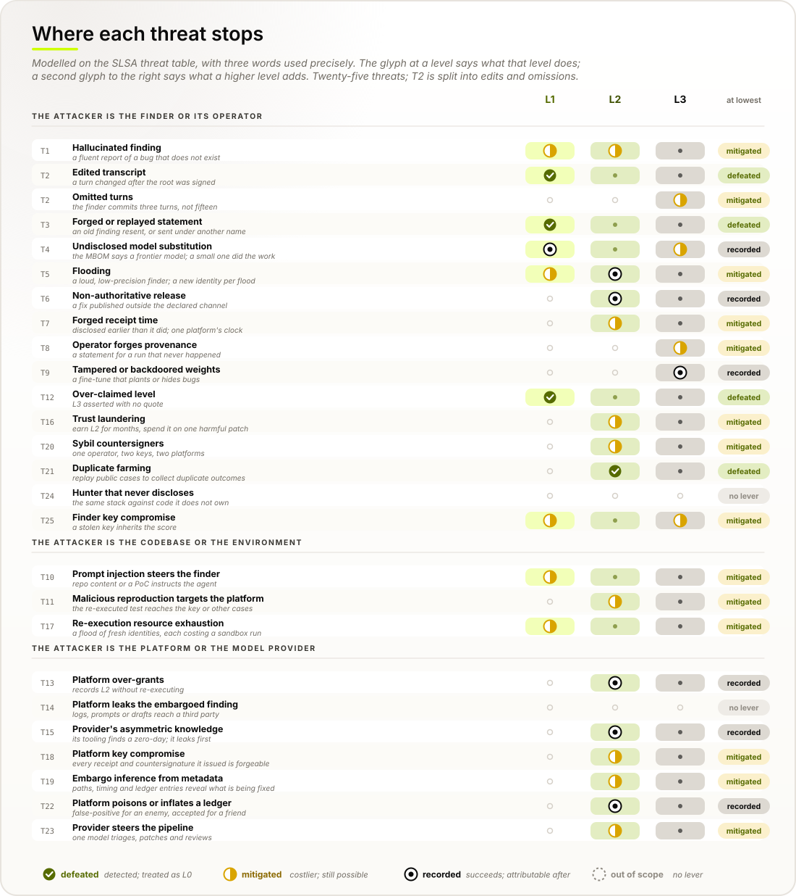

# Threats

This table does what the SLSA threat table does: for each attack on a machine-to-machine disclosure, it
names the lowest level at which the receiver can act on it, how, and what remains. Attacks are grouped by what
the attacker controls. Three words are used precisely:

- **Defeated at Ln**: at that level the receiver detects the attack mechanically and treats the disclosure as
  L0 before acting on it.
- **Mitigated at Ln**: the level raises the attack's cost or narrows it; the attack can still succeed.
- **Recorded at Ln**: the attack succeeds; the level makes it attributable to an identity after the fact.

The first draft of this table said "defeated" in several rows where only "mitigated" or "recorded" is true.
The rows are corrected below; the difference is the point of the table.

## The attacker is the finder or its operator

| Id | Threat | Example | Status | How | Residual |
|---|---|---|---|---|---|
| T1 | Hallucinated finding | a fluent report of a bug that does not exist; the maintainer spends an hour to learn that | Mitigated at L1, further at L2 | L1 requires a test executed by code (VSLA-F-5), which removes reports that were never run; L2 requires the platform to re-run it at the subject revision, classify the failure with its own classifier, and check the test touched the files the report names (VSLA-P-4) | a finder can author a test that fails on demand; L1 proves reproducibility, not validity, and the semantic judgement remains the receiver's |
| T2 | Edited or cherry-picked transcript | the finder edits a turn after the fact, or shows the three turns that look good and hides the twelve where it floundered | Edits: defeated at L1. Omissions: mitigated at L3 | the Merkle root (VSLA-F-4) makes any change after commitment visible; omission before commitment is invisible to a root, and only a recorder running inside the measured harness (L3) can attest completeness | at L1 and L2 the finder chooses what to commit; the finder can refuse to release leaves |
| T3 | Forged or replayed statement | an old finding resent as new; a statement under another finder's name | Defeated at L1 | subject binds the revision; DSSE signature under a pinned key (VSLA-F-1, VSLA-V-1); the platform's intake uses nonces and expiries on the transport | finding *theft* is not replay: finder B can copy A's predicate, swap in its own key and sign; only a receipt timestamp (L2) settles priority, and only among submissions to that platform |
| T4 | Undisclosed model substitution | the MBOM says a frontier model; a small quantized model did the work | Recorded at L1; mitigated at L3 | the MBOM is signed (VSLA-F-3); at L3 the quote binds the weight digests that ran (VSLA-F-15) | at L1 and L2 any model is taken on the operator's word; an API-served model cannot be measured at any level |
| T5 | Flooding | a loud, low-precision finder floods the intake | Mitigated at L1 (cost), recorded at L2 (identity) | admission control (VSLA-P-12) bounds what an unknown identity can make the platform execute; the ledger makes precision visible and the floor keeps low-precision finders at L1, where policy routes them to a slower lane | a new identity per flood; the L2 floor's age gate makes the new identity worth less, not nothing |
| T6 | Non-authoritative release | the finder publishes a fix outside the maintainer's channel before the embargo ends | Recorded at L2 | the statement names the authoritative channel (VSLA-F-10); a release elsewhere is a disqualifying ledger outcome (VSLA-F-12) that follows the identity | the framework cannot physically prevent a leak |
| T7 | Forged receipt time | the finder claims it disclosed before an exploit appeared, or before a competitor | Mitigated at L2 | the platform countersigns receipt time (VSLA-P-3); the receipt is anchored by log inclusion (VSLA-P-16), which upper-bounds `receivedAt` and fixes the evaluation instant (VSLA-V-7) | a platform that misstates time, in particular one that holds a receipt and anchors it late; a platform operated by the finder's operator; a `signed-timestamp` anchor is one more key's word, not a log |
| T8 | Operator forges provenance | the operator signs a statement for a run that never happened, or ran a different pipeline than the harness digest says | Mitigated at L3 | the signing key lives in the attested environment and the quote binds it to an allowlisted measurement (VSLA-F-16, VSLA-V-6) | the operator still controls the enclave's inputs (repository, network, tool results); a measured harness fed forged inputs produces a measured, forged run |
| T9 | Tampered or backdoored weights | a fine-tune that plants a vulnerability in its own patches, or hides a class of bugs | Recorded at L3 | the quote binds the weight digests; each matches a provider-signed attestation (VSLA-F-17); the MBOM traces the model to every disclosure it touched | attestation proves which bytes ran, not what they do; a backdoor in the provider's own base weights is invisible; the only structural defence is reviewer diversity on the Patch track (VSLA-P-10) |
| T12 | Over-claimed level | the finder asserts L3 with no quote | Defeated at L1 | verification computes its own level (VSLA-P-9); repeated over-claims lower the score and disqualify at half the window | none |
| T16 | Trust laundering | a patient finder earns L2 over months, then spends it on one harmful change: a weakened check, a payload in a fixture, a build-script edit | Mitigated at L2 | the receiver's own review on a different model family (VSLA-P-10); the source-only scope rule caps patches that touch build, CI, fixtures, binaries or manifests at L1 (VSLA-F-18); `retracted` is disqualifying and retroactive (VSLA-P-15) | a level is evidence about this disclosure, not a prediction about the next; a source-only diff can still be subtly wrong; the defence is that L2 never means "merge unread" on a security-sensitive surface |
| T20 | Sybil or colluding countersigners | one operator runs two finder keys and two "platforms" and countersigns itself to L2; or presents another finder's published ledger as its own | Mitigated at L2 | a verifier counts only countersigners it has pinned, per operator (VSLA-V-5); entries are bound to the finder key and the track; the floor has a hard age gate and a distinct-countersigner floor | the allowlist is the verifier's judgement; two pinned operators can still collude |
| T21 | Duplicate farming | a finder replays public cases to collect `duplicate` outcomes | Defeated at L2 | `duplicate` is neutral in the rubric: it neither raises nor lowers the score, so it buys nothing | none |
| T24 | Non-participating hunter | the same stack runs against code the operator does not own and never discloses | Out of scope | VSLA's levers (ledger, floors, outcomes) act only on identities that submit statements; the authorization basis (VSLA-F-19) is recorded, not enforced | VSLA does not reduce the offensive capability of autonomous hunters; its claims are limited to making disclosures checkable |
| T25 | Finder key compromise | a stolen key inherits the finder's score | Mitigated at L1, further at L3 | validity windows and operator-signed `revoke` entries, evaluated at `t_eval` so a thief cannot backdate around them (VSLA-F-20, V-7); a `successor` entry carries history to a new key without carrying the thief | reputation is attached to a key; statements the thief anchored before the revocation stand; at L3 the key cannot leave the environment |

## The attacker is the codebase or the environment

| Id | Threat | Example | Status | How | Residual |
|---|---|---|---|---|---|
| T10 | Prompt injection steers the finder | a comment in the repo tells the agent to report nothing, or to report a decoy; a PoC in a report tells the triage agent to rate it critical | Mitigated at L1, eliminated at none | untrusted-input wrapping and injection scanning are required (VSLA-F-7); flags go in the statement; the receiver's reviewer on the Patch track sees none of the patcher's reasoning | this is the open problem of agentic security; VSLA makes injections visible and auditable, not impossible |
| T11 | Malicious reproduction targets the platform | the PoC, executed as a test by the platform's mandatory re-execution, reaches the host, the platform's signing key, its tokens or other embargoed cases | Mitigated at L2 | isolation requirements (VSLA-P-11): no egress, no key access, ephemeral filesystem, resource caps, distinct principal, `vm` isolation in production; the isolation class is in the receipt | a sandbox bug; a platform that runs `process` isolation in production; the platform key is the whole of L2, so a key kept beside the sandbox is the prize |
| T17 | Re-execution resource exhaustion | a flood of fresh identities, each costing a sandbox run | Mitigated at L1 | admission control and deferral for identities without a ledger (VSLA-P-12) | an unknown identity still costs the platform something; the slow lane is the answer, not L0 |

## The attacker is the platform or the model provider

| Id | Threat | Example | Status | How | Residual |
|---|---|---|---|---|---|
| T13 | Platform over-grants | a platform records L2 without re-executing | Recorded at L2 | receipts name the re-execution status and sandbox class; countersignatures are in finders' ledgers; a maintainer verifying the finder's statement directly needs nothing from the platform; a third-party verifier requires an anchored receipt (VSLA-P-16) | a platform that colludes with a finder; the maintainer's countersigner allowlist is the defence |
| T14 | Platform leaks the embargoed finding | the platform's logs, prompts or advisory drafts reach a third party | Out of scope | the embargoed profile keeps the statement itself free of paths, commands and files; the rest is the platform's own security | a compromised platform |
| T15 | Model provider's asymmetric knowledge | a provider's internal tooling finds a zero-day and it leaks before the maintainer is told | Recorded at L2, only if the provider's finder is a VSLA identity | its ledger records what it disclosed, where and when; a non-authoritative leak is a ledger outcome; the maintainer's receipt is proof of order | a provider that chooses not to participate; VSLA creates the norm and the evidence, not the obligation |
| T18 | Platform key compromise | whoever holds the platform key forges every receipt and ledger countersignature that platform ever issued | Mitigated at L2 | keys in a separate process or hardware token (VSLA-P-11); validity windows evaluated at the anchor's time (VSLA-V-7), so a receipt the thief backdates fails once the key's window closes; log-inclusion anchors make forged time detectable | a popular platform's key is a high-value target and the design centralises it; countersigned ledger entries carry no third-party time, so a stolen countersigner key can backdate entries within its window |
| T19 | Embargo inference from metadata | which projects are being probed, which files, when the fix is coming, read from statement fields, ledger timing or status polling | Mitigated at L2 | the embargoed profile (digests for test path, command, files touched); no per-case metadata or ledger entries exposed until the case is public (VSLA-P-13); ledger publication delayed | a published fix is the disclosure; the window between the fix and dependents updating is not VSLA's to close; and the finder's own ledger: P-13 binds the platform, but F-11 has the finder present every entry for the track to every platform it submits to, so platform B reads which countersigners (often a named project) closed which cases for this finder, when, and with what outcome, including cases that will never be public, such as a `rejected` that meant "real but won't fix" |
| T22 | Platform poisons or inflates a ledger | a platform writes `false-positive` for a finder it dislikes, or `accepted` for a friend; or its own reproducer agent fails and it blames the finder | Recorded at L2 | every negative outcome carries an auditable signed reason; `accepted` and `false-positive` have defined meanings (VSLA-P-6, P-15: a false-positive rests on the platform's re-execution of the finder's own test); entries are auditable by other platforms; a verifier pins the countersigners it believes | no dispute protocol yet; a finder's recourse is other platforms' allowlists |
| T23 | Model provider steers the pipeline | the provider's model triages, patches and reviews, and its outputs steer every decision | Mitigated at L2 (Patch) | reviewer diversity (VSLA-P-10) means no single model family approves its own patch | an API-served model is unverifiable at every level; a platform whose every role runs on one provider has one point of failure |

## What VSLA does not try to do

- It does not judge severity. CVSS and the lane are the triage agent's output and are not part of the level.
- It does not replace the maintainer's review of a patch; it tells the maintainer how much review the
  evidence has earned. A level is an input to triage ordering, never to review depth on a security-sensitive
  surface.
- It does not make a wrong model right. A badly behaved model at L3 is a badly behaved model whose behaviour
  is perfectly attributable.
- It does not constrain a hunter that never discloses, and it does not reduce what such a hunter can do.
- It does not settle disputes between a finder and a platform about a ledger entry; it makes both sides'
  claims signed and auditable.
