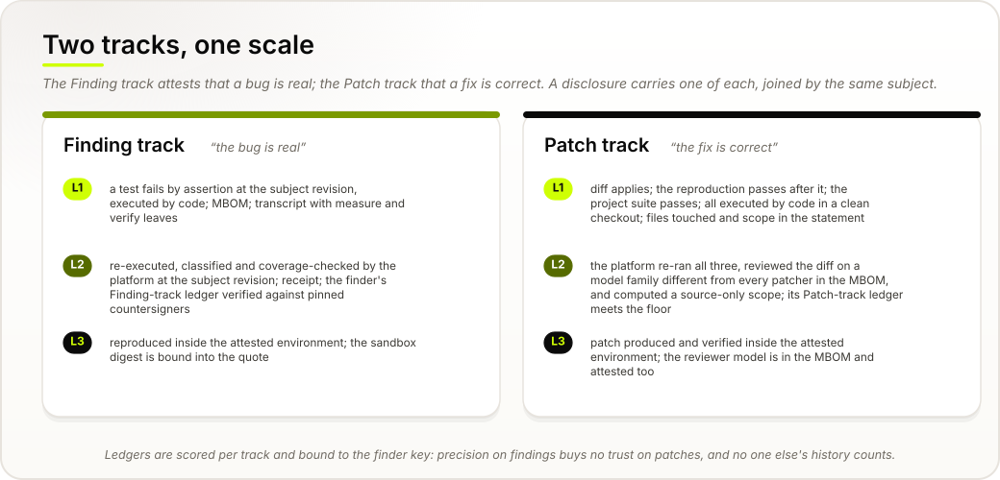

# Tracks

A machine-to-machine disclosure makes two claims that are verified differently: *this bug is real* and *this
fix is correct*. VSLA keeps them on separate tracks, each with the same L0 to L3 scale, so a receiver can say
"Finding L2, Patch L1" and mean something precise. SLSA made the same split between its Build and Source
tracks for the same reason.

A statement declares its track in `predicate.track`. A disclosure that carries a patch SHOULD carry one
statement per track, both with the same `subject[0]` (the finding) so they can be joined. Ledger entries name
their track, and a verifier scores each track's ledger separately: precision on findings buys no trust on
patches.

## Finding track

The claim: the codebase at the stated revision contains the stated vulnerability.

| Level | Added requirement |
|---|---|
| L1 | A test that fails on the vulnerable revision with an assertion (per the normative classifier, not a collection error or missing import), re-run by code at the subject revision; MBOM; Merkle transcript with measure and verify leaves; authorization basis; signed statement |
| L2 | Re-executed by the receiving platform in its own isolated sandbox at the subject revision, classified by the platform, with the test shown to load the package the platform's own configuration names; receipt countersigned; finder's ledger verified against pinned countersigners and meets every floor |
| L3 | Reproduction executed inside the attested environment; sandbox digest bound into the quote |

## Patch track

The claim: applying the stated diff to the stated revision makes the finding's test pass and keeps the
project's test suite passing.

| Level | Added requirement |
|---|---|
| L1 | The diff applies cleanly; the reproduction test passes after it; the project suite passes; all three executed by code in a clean checkout, not asserted by a model; the files touched and the computed scope are in the statement; MBOM; transcript; signed statement |
| L2 | The **receiving platform** re-ran all three executions and ran its **own adversarial review** on a model family different from every patcher in the MBOM, over the diff and test output only, with the verdict in the receipt; the platform computed `scope: source-only` from the diff (a change to build, CI, fixtures, binaries, manifests or release tooling caps the track at L1); countersigned; ledger floor met |
| L3 | Patch produced and verified inside the attested environment; the reviewer model is in the MBOM and attested too |

The Patch track is the one that matters for the question maintainers actually ask of machine-generated
patches ("do I have to read this carefully, or can I merge it?"), and it is the track the pilots in the
paper measure. The honest answer VSLA gives is narrower than "merge it": Patch L2 means less review is needed
to confirm that the fix closes the finding and passes the suite; it never means a change to a
security-sensitive surface may be merged unread. The finder's own `patch.review` is carried for context and
satisfies nothing.
