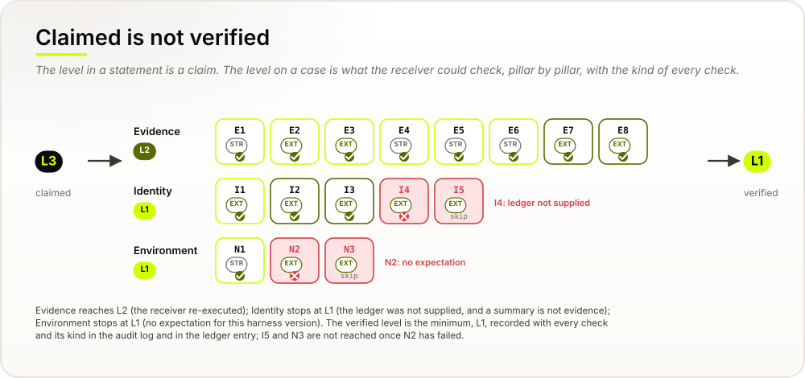

# Verification

<p align="center"></p>

A statement carries a *claimed* level. A receiver computes a *verified* level, which is what it records on
the case, shows in its interfaces, and feeds into its policy (which lane, how much human review). The verified
level is never higher than the claimed one and is often lower; that is not an error but the point.

Every check is either **external** (it compares the statement against something the finder did not write: a
pinned key, an expectation the receiver obtained independently, or the receiver's own execution) or
**structural** (it checks the statement against itself). Only external checks separate the levels; structural
checks reject malformed statements. A reader of a verification record can tell which is which.

## Procedure

Inputs: the DSSE envelope; the pinned keyring (finder, platform, maintainer, provider, root, operator and log keys
with validity windows); the receiver's **expectations** (harness digests per version; allowlisted measurements);
the platform's receipt, if one exists; the finder's ledger entries; the last ledger root and count this
receiver saw for this finder; the transcript leaves if the policy requires them; the report; the code at
`subject[1]` and a sandbox, if the verifier has them; the ledger entries this verifier itself countersigned for the
finder (`required_entries`, each of which must be included in the presented ledger); and the verifier's policy knobs:
whether a receipt must be anchored and whether a `signed-timestamp` may satisfy that (`require_anchor`,
`accept_timestamp_anchor`, VSLA-P-16) and the lowest isolation class it accepts a re-execution from
(`require_isolation`, VSLA-P-11).

Every time-dependent check is judged at one instant, `t_eval` (VSLA-V-7): the anchor's `integratedTime` when the
receipt's anchor verifies, else the receipt's `receivedAt`, else the verifier's clock. A verification is therefore a
function of its inputs: the same anchored statement verifies identically today and in a year.

Every signed payload (statement, receipt, ledger entry, weight attestation, anchor) MUST be byte-canonical RFC 8785
with no duplicate keys; a verifier parses it strictly, so two conforming verifiers cannot read different values from
one signature. A malformed input of any kind is a failed check, never an exception (VSLA-V-3).

For each pillar, run the checks in order; the pillar's level is the highest level all of whose checks passed.
The statement's verified level is the minimum across pillars and the claimed level.

### Evidence

| # | Level | Kind | Check |
|---|---|---|---|
| E1 | L1 | structural | Envelope parses and the payload is byte-canonical with no duplicate keys; `payloadType` is `application/vnd.in-toto+json`; `_type` and `predicateType` are correct; the predicate validates against the schema (which requires `claimedLevel` and `authorization`). |
| E2 | L1 | external | A `finder:` signature verifies under a pinned finder key over `PAE(payloadType, payload)`, and `finder.publicKey` is that key. |
| E3 | L1 | external | `subject[0].digest` equals the digest of the accompanying report; `subject[1]` names a commit; `reproduction.revision` equals it; `timestamps` and `reproduction` times are ordered and `finishedAt` is not ahead of the verifier's clock. Without the report, the binding and ordering checks still run (structural). |
| E4 | L1 | structural | `mbom.models` is non-empty, every model has a serving mode, and every self-hosted or TEE model carries a weight digest or `unmeasured: true`. |
| E5 | L1 | structural | If leaves were supplied: the RFC 6962 root equals `transcript.root`, the count equals `leafCount`, leaf 0 is a `measure` leaf, and a `verify` leaf exists whose command (or its digest), exit, classification and output digest equal the `reproduction` section. The finder wrote both the leaves and the section, so this is self-consistency: it rejects an inconsistent statement and separates no level. Without leaves, only the root's presence is checked, and a policy that requires leaves fails the check. |
| E6 | L1 | structural | `reproduction.executor == "code"`; exactly one of `command` (published profile) or `commandDigest` (embargoed profile) is present; on the Finding track `observedExit == expectedExit == 1` and `securityFailure` is true; on the Patch track `applied`, `reproductionPasses` and `suitePasses` are true. This is the finder's own account. |
| E7 | L2 | external | Someone other than the finder re-executed the reproduction **at the subject revision** with `status: matched`: the verifier itself (VSLA-V-4), or the platform whose receipt **I3 has already verified** (a receipt that failed I3 is not evidence and is ignored here). Finding track: the receiver's own classifier says `securityFailure` and the test `touchedSubject` (imported or covered the package the receiver's own configuration names; see VSLA-P-4 for what that does and does not prove). Patch track: `applied`, `reproductionPasses`, `suitePasses`. If the verifier's policy names a minimum isolation class, the re-execution's `sandbox.isolation` must meet it. |
| E8 | L2 (Patch) | external | The receipt (or the verifier's own re-execution) carries the receiver's adversarial review with `approved: true` and `distinctFamily: true`, and the receiver computed `scope: source-only` from the diff. The finder's `patch.review` is informational and never satisfies this check. |

There is no Evidence check at L3: the environment, not the evidence, is what L3 adds.

### Identity

| # | Level | Kind | Check |
|---|---|---|---|
| I1 | L1 | external | The finder key is pinned and valid at `t_eval` (inside its window, and not named, nor any predecessor in its successor chain, by a `revoke` entry signed under a pinned `operator:` key with `at` not after `t_eval`); `finder.operator`, `finder.harness.digest` and `authorization.basis` are present. The detail names the instant and the revoking operator. |
| I2 | L2 | external | `channel.intake` is this platform (or, for a third-party verifier, the channel the codebase declares), and `channel.intakeKey` equals a pinned `platform:` key; that key is the one whose receipt I3 accepts. |
| I3 | L2 | external | The receipt is a DSSE envelope with the receipt payload type whose payload is canonical, signed under the keyid `platform:<name>` whose pinned public key equals `channel.intakeKey` (a receipt under a `finder:`, `maintainer:` or any other pinned key is not a receipt; a receipt from a different pinned platform does not count), valid at `t_eval`; its `statementDigest` equals this envelope's payload digest, its `channel` equals `channel.intake`, `finishedAt <= receivedAt <= now + skew`, and `reexecution.status` is present. If the receipt carries an `anchor`, it is verified under the pinned `log:` key (a `log-inclusion` anchor by inclusion proof and checkpoint signature; a `signed-timestamp` by its signature over the receipt digest), must commit to this receipt body, and `receivedAt <= integratedTime <= now + skew`. When the policy requires an anchor (every third-party verifier should, VSLA-P-16), only a verified `log-inclusion` anchor satisfies it unless the policy accepts timestamps, and a receipt that does not satisfy it fails I3 and is not read by E7/E8. |
| I4 | L2 | external | The ledger entries were supplied (a summary alone fails); every entry is a canonical DSSE payload; the root over them in presented order equals `history.root`; if this receiver stored a previous (root, count) over the ledger it was shown for this finder and track, the new ledger extends it (the prefix root matches, else `ledger-fork`); every entry this receiver itself countersigned is included, by canonical bytes, at any position (else `ledger-fork`); after dropping outcome entries whose countersignature does not verify under a pinned key, **and entries whose `finder` is neither this statement's `finder.publicKey` nor a predecessor in its successor chain, or whose `track` is not this statement's track** (a published ledger is not a credential another key can present, and a Finding record buys no Patch trust), the [rubric](trust-rubric.md), with its window ordered by countersigned `at` and its decay evaluated at `t_eval`, meets every floor (score, entries, countersigners, age). The self-reported `history.score` is not consulted. |
| I5 | L3 | external | The `enclave:` signature on the envelope verifies under the key that the **verified** quote binds (`environment.enclaveKey`). If N3 failed, I5 fails. |

### Environment

| # | Level | Kind | Check |
|---|---|---|---|
| N1 | L1 | structural | Every model in the MBOM declares a serving mode. |
| N2 | L2 | external | Leaf 0 (or `firstLeaf` when leaves were not supplied) is a `measure` leaf whose harness digest equals both `finder.harness.digest` and the receiver's **expectation** for that harness name and version, and whose sandbox digest equals `reproduction.sandbox.digest`; every weight attestation present in the MBOM verifies under a pinned `provider:` key and matches the MBOM digest. Without an expectation for the harness, N2 fails: there is nothing external to compare to. Below L3 the measurement is the finder's own and a finder can copy a published expectation into its statement, so N2 at L2 is external in form and detects honest drift (a mis-versioned harness), not fraud; the measurement becomes evidence only when the quote binds it (N3). |
| N3 | L3 | external | `environment.type` is not `none`; no model is API-served; the quote verifies under the pinned root of trust through the adapter for that environment type (for `two-operator`, under at least two **distinct** pinned co-signer roots); the quote binds exactly the enclave key, harness digest, weight digests and sandbox digest the statement carries; `measures` covers `weights`, `harness`, `policy`, `sandbox`, `signingKey`; the (type, measurement, harness) triple is in the receiver's allowlist, and when the allowlist entry names a co-signer set the statement's set equals it; every self-hosted or TEE model carries a verified provider attestation. |

## Recording the result

The platform records, in its tamper-evident audit log and on the case ([VSLA-P-1](requirements.md)):

```json
{"claimed": 3, "verified": 1,
 "pillars": {"evidence": {"level": 2, "failed": null},
             "identity": {"level": 1, "failed": "I4", "checks": [{"id": "I4", "level": 2, "ok": false, "kind": "external", "detail": "ledger not supplied: a self-reported summary is not evidence"}]},
             "environment": {"level": 1, "failed": "N2"}}}
```

A finder that claims above what it can show is not punished for one over-claim, but repeated over-claims are
visible in its ledger (every entry carries claimed and verified) and lower its score (rubric component *C*,
and a disqualification when half the window over-claims). A platform that records verified levels it did not
check is equally visible, because its countersignatures are in finders' ledgers and can be audited by other
platforms, and because its receipts name the sandbox isolation class and status of every re-execution.

## Who verifies

- **The disclosure platform**, on receipt and again before each gate (open PR, publish advisory). This is the
  common case and the one qudisclose implements.
- **The maintainer**, when the platform is not their own: they verify the platform's receipt and the finder's
  statement before trusting the platform's verified level, and they decide which countersigners to pin.
- **A coordinator or CERT**, who holds only read access: they verify the statement and the ledger without the
  code and get a level with Evidence capped at L1 (they cannot re-execute), which is the honest answer.
- **Anyone, later**: the statement, the receipt and the ledger are enough to settle "who knew what, when"
  to the extent they trust the platform's clock, which is why receipts should be anchored in a transparency
  log ([VSLA-P-16](requirements.md)).

## What the reference verifier implements

`tools/vsla_verify.py` implements every check above, with `--require-anchor`, `--accept-timestamp-anchor`,
`--required-entries`, `--require-isolation` and `--platform-key` as the policy knobs. Its environment adapter is the
`signed-quote` form, which stands in for a hardware quote and proves only that a pinned root key signed the bindings;
SEV-SNP, TDX and Nitro adapters are not implemented and a statement whose `environment.type` names one verifies at
L2 in this verifier. It verifies both anchor forms (`log-inclusion` with a checkpoint and inclusion proof under a
pinned `log:` key, and `signed-timestamp`); a Rekor or SCITT adapter would map their proofs onto the `log-inclusion`
form. It processes `successor` and `revoke` ledger entries and evaluates every window at `t_eval`. It does not fetch
anything: ledgers, expectations, attestations and the verifier's own entries are inputs.

The third round added, and the suite pins: a platform-assigned `seq` that forked honest concurrent closes (the finder
now owns the index and the platform checks inclusion, not position), key windows evaluated at self-asserted times
(now `t_eval`), unimplemented `successor`/`revoke` (now processed), a timestamp read as log inclusion (now two named
forms), an unanchored receipt still feeding E7 under `require_anchor` (now gated), a rubric that depended on the
verifier's wall clock (now evaluated at `t_eval`, and `history.score` is no longer consulted), a junk DSSE signature
vetoing a valid one, and a 100 000-deep payload escaping `verify()`.

The attacks two review rounds demonstrated against earlier revisions of this verifier, and the check that now closes
each, are each pinned by a test in `tests/test_reference.py`: a self-reported ledger summary (I4), unverified
countersignatures (I4), a receipt signed by the finder's own pinned key (I3, and E7 no longer reads an unverified
receipt), another finder's published ledger (I4 finder binding), a Finding ledger presented with a Patch statement
(I4 track binding), a finder-ordered window (I4: the window is ordered by countersigned `at`), two colluding keys on day zero (floors and age gate),
duplicate farming (neutral outcomes), a two-operator quote co-signed twice by one root (N3), a pinned enclave key (I5 now
derives it from the quote), a non-canonical payload with duplicate keys (E1), and a receipt dated in the future (I3).
